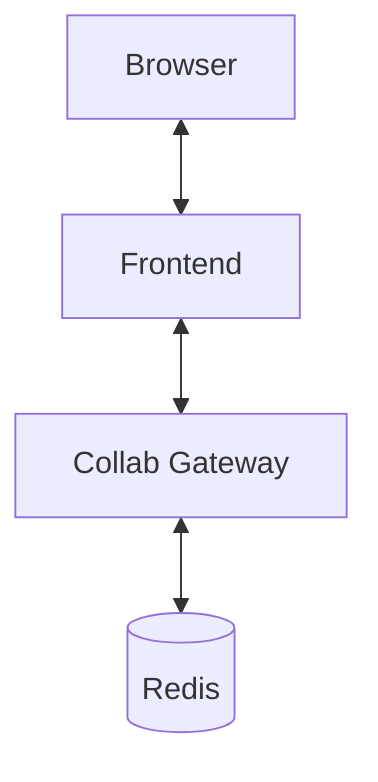

# Architecture

CollaTeX is split into a React frontend and a WebSocket collaboration gateway
powered by Yjs. Editing state flows from the browser to the gateway and back to
other peers. Persistence is in-memory by default but can be extended with
Redis.

## Frontend

- React + Vite.
- CodeMirror 6 editor wired to Yjs.
- MathJax renders LaTeX previews.

## Collab Gateway

- Stock `y-websocket` server listening on `localhost:1234`.
- Rooms are ephemeral and exist only in memory.
- Optional Redis adapter for persistence.

## Security model

The Vite dev server relaxes the Content Security Policy to permit inline
scripts and `eval` for tooling like React Refresh. Production builds remain
locked down, relying on the strict CSP defined in `apps/frontend/nginx.conf`.

## Security TODO

- Replace the temporary `better-xss` sanitiser with an AST-based policy.
- Harden the Content Security Policy.

